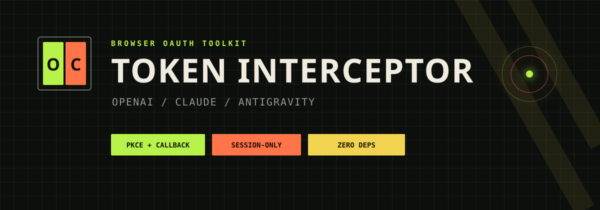

<p align="center">
  
</p>

<p align="center">
  <a href="README_EN.md">English</a> · 简体中文
</p>

<p align="center">
  
  
  
  
  
</p>

# openai/claude Token Interceptor

一个面向开发者的浏览器 OAuth 工具箱，在同一个 Manifest V3 扩展中完成 OpenAI、Claude 和 Antigravity 的授权、回调捕获与 Token 导出，并支持导入 Grok 的 SSO 登录 Cookie 及一键导出各服务商账户凭据。

它不是账号管理器，也不上传凭据。所有敏感数据只保存在浏览器本地或当前浏览器会话。

## 为什么用它

| 能力 | OpenAI | Claude | Antigravity | Grok |
| --- | :---: | :---: | :---: | :---: |
| 一键生成官方授权 URL | ✓ | ✓ | ✓ | ✓ |
| 自动识别 OAuth 回调 | ✓ | ✓ | ✓ | ✓ |
| 手动粘贴授权码 | ✓ | ✓ | ✓ | ✓ |
| Access / Refresh Token | ✓ | ✓ | ✓ | ✓ |
| Session 登录导入 | ✓ | ✓ | - | ✓ |
| 兼容监听已有 Token 请求 | - | ✓ | - | - |
| 账户凭据捕获（Cookie/Session） | ✓ | ✓ | - | ✓ |
| 本地 JSON / TXT 导出 | ✓ | ✓ | ✓ | ✓ |

- **一个入口**：不再为每个提供商安装一套临时脚本或扩展。
- **真实 OAuth**：使用各平台官方授权页和 Token 端点。
- **清晰隔离**：三套流程使用独立存储键和状态机，互不覆盖。
- **零运行依赖**：没有构建步骤，没有 npm 运行依赖，加载目录即可使用。
- **可审计**：协议、权限和数据存储均为普通 HTML/CSS/JavaScript。

## 快速开始

OpenAI、Claude、Antigravity 和 Grok 均无需填写额外配置。

### 1. 下载并加载扩展

- **方式 A（推荐，直接下载安装包）**：点击下载最新扩展压缩包 [`token-interceptor.zip`](https://github.com/lsy1770/TokenInterceptor/releases/latest/download/token-interceptor.zip)（或在 [Releases](https://github.com/lsy1770/TokenInterceptor/releases) 选择历史版本），解压到一个本地文件夹。
- **方式 B（从源码加载）**：克隆本仓库。

随后在浏览器中加载：

1. 打开 `chrome://extensions/` 或 `edge://extensions/`。
2. 开启“开发者模式”。
3. 点击“加载已解压的扩展程序”。
4. 选择解压后的目录（或本项目根目录），即包含 `manifest.json` 的目录。

### 2. 开始授权

点击浏览器工具栏中的扩展图标，选择 OpenAI、Claude、Antigravity 或 Grok，然后点击平台面板中的主按钮。

## 平台说明

### OpenAI

扩展生成 PKCE 参数并打开 OpenAI 授权页。授权完成后浏览器会访问 `localhost:1455/auth/callback`，扩展在导航发生前捕获 code 并自动交换 Token。

额外支持：

- 从 OpenAI 页面响应中捕获 Token。
- 手动输入 authorization code 和 code verifier。
- 导入 ChatGPT `sessionToken` 并写入本机登录 Cookie。
- 将最多 20 条历史记录导出为 TXT 或 JSON。

### Claude

扩展生成 Claude PKCE 授权 URL，并从 Anthropic 官方回调页面识别授权码。Token 交换在临时的 `platform.claude.com` 浏览器上下文中完成。

“监听已有请求”是兼容模式，会临时使用 `chrome.debugger` 读取 Claude Token 响应体。完成或手动停止后会立即解除监听。

额外支持导入 Claude `sessionKey` 登录 Cookie（也可粘贴完整 Cookie 字符串或 JSON），在本机写入 `sessionKey`、`lastActiveOrg`、`anthropic-device-id`、`routingHint`。

### Antigravity

扩展通过内置的 Google 桌面 OAuth 流程获取 Antigravity 离线凭据：

- 六个 Antigravity/Google scope。
- `access_type=offline` 和 `prompt=consent`。
- 独立 loopback 回调 `localhost:1456/oauth-callback`。
- 自动读取 Google 邮箱和账号名称。
- 导出 `access_token`、`refresh_token`、`id_token` 和 OAuth 元数据。

### Grok

扩展为 Grok 提供两种登录方式。

**OAuth Token 获取**：

- 通过 Grok 官方授权页完成 PKCE（S256）授权。
- 自动捕获 `127.0.0.1:51234/callback` 回调并交换 `access_token`、`refresh_token`、`id_token`。
- 从 `id_token` 解析邮箱和名称，也支持手动粘贴授权码。

**SSO Cookie 导入**：

- 粘贴 `sso` Cookie 值（JWT）、完整 Cookie 字符串，或 `/api/auth/session` 返回的 JSON。
- 在本机写入 `sso`、`sso-rw` 以及可选的 `x-userid` Cookie。
- 导入成功后可选打开 grok.com 验证登录状态，导入会覆盖当前 Grok 登录状态。

### Google One / Gemini

面向 **Google One 订阅开通与取消续费** 的两步操作，配套 `google_one_daichong.py` 这类协议脚本使用。

**一键取 Cookie**：

- 跨 `accounts.google.com`、`play.google.com`、`one.google.com`、`gemini.google.com`、`payments.google.com` 读取当前登录态，去重合并后一次性导出。
- 同一份数据给出四种格式：
  - Netscape `cookies.txt` —— 直接 `python google_one_daichong.py cancel --cookie-file cookies.txt`
  - Cookie header 串 —— 粘进任何 HTTP 客户端
  - 完整 JSON —— 含 `summary` 能力判定与 `cookies` 数组，便于跨机迁移
  - Python 直贴片段 —— 已内置 `COOKIES` 列表与 `sapisidhash()` 实现
- 能力判定会明确告诉你缺什么：`SAPISID` / `__Secure-1PAPISID`（`SAPISIDHASH` 的签名材料）、`SID`+`HSID`+`SSID`（Google 账号强会话）、`play.google.com` 会话（取消续费的 RPC 都在这个域下）。三者齐备才标「可取消续费」。

**Cookie 注入登录**：

- 粘贴 `cookies.txt` / header 串 / 本插件导出的 JSON，自动识别格式（Netscape、JSON、`a=b; c=d`），无需手动整理。
- Chrome 侧约束已处理：`SameSite=None` 强制 `Secure`、`__Host-` 前缀 cookie 走 host-only 写入、会话 cookie 不写 `expirationDate`、过期时间自动抬到未来。
- 「先清理当前 Google 会话」默认开启，避免新旧账号 hash 混在一起串号。
- 注入前自动快照当前 Google 登录态，随时可「恢复上次登录态」一键回滚。
- 可勾选注入后直接打开 Play 订阅页，落库即验证。

**账号探测**：拉取 `one.google.com/u/0/ai` 解析 `SNlM0e`（RPC 用的 at）、`S06Grb`（GAIA 号）与邮箱，用来确认现在注入的是哪个账号、凭据是否齐备。

### 凭据捕获

「凭据」页签从当前浏览器已登录的站点读取账户凭据，一键导出为 JSON：

- **OpenAI**：请求 `chatgpt.com/api/auth/session`，保存返回的完整 session，并读取 `__Secure-next-auth.session-token` Cookie。
- **Claude**：读取 `anthropic-device-id`、`lastActiveOrg`、`sessionKey`、`routingHint` 四个 Cookie。
- **Grok**：读取 `sso`、`sso-rw`（及可选 `x-userid`）Cookie。

支持一键捕获全部或单独捕获某个服务商，结果可复制或导出为 JSON 文件。

## 安全边界

- OpenAI 历史 Token 保存在 `chrome.storage.local`，最多 20 条，可随时清除。
- Claude 和 Antigravity Token 保存在 `chrome.storage.session`，浏览器会话结束后自动清除。
- Grok 登录 Cookie 直接写入浏览器 grok.com 的 Cookie 存储，可随时清除或再次导入覆盖。
- 凭据捕获只在本机读取已登录站点的 Cookie 或 Session，结果仅保存在 popup 内存与导出的文件中。
- Google Cookie 注入前会把当前 Google 登录态快照写入 `chrome.storage.local`（键 `googleCookieBackup`），回滚后可用「清除快照」删除；导出的 `cookies.txt` / JSON 是明文凭据，用完请自行删除。
- 扩展不会上传 Token，不接入遥测或第三方分析。
- Claude 的 `debugger` 权限只用于用户主动开启的兼容监听和浏览器上下文 Token 交换。
- 外部回调会校验主机、路径和 OAuth state，拒绝不匹配的输入。

完整说明见 [安全策略](SECURITY.md)、[隐私说明](docs/PRIVACY.md) 和 [架构文档](docs/ARCHITECTURE.md)。

## 项目结构

```text
.
├── assets/icons/             # 扩展图标
├── docs/                     # 架构与品牌资源
├── scripts/                  # 项目校验脚本
├── src/
│   ├── oauth/                # Claude / Antigravity / Grok 协议模块
│   ├── background.js         # Service worker 与消息路由
│   ├── callback.js           # Claude 回调页面识别
│   ├── content.js            # OpenAI 内容脚本桥接
│   └── injected.js           # OpenAI 页面上下文监听
├── tests/                    # Node.js 零依赖测试
├── ui/                       # Popup HTML / CSS / JavaScript
├── manifest.json
└── package.json
```

## 开发与验证

要求 Node.js 20 或更高版本，仅用于测试和校验，扩展运行本身不依赖 Node.js。

```powershell
npm test          # OAuth 解析、Token 解析与后台 smoke test
npm run check     # Manifest、路径、JavaScript 和 DOM 引用检查
npm run verify    # 执行全部质量检查
npm run package   # 生成可分发的扩展 ZIP 安装包到 dist/
```

修改扩展后，在扩展管理页点击“重新加载”。协议或权限变更必须同步更新测试与文档。

## 常见问题

**授权回调页面显示无法访问，是否失败？**

不一定。OpenAI 和 Antigravity 使用 loopback 地址，扩展会在导航阶段捕获 code。返回弹窗查看状态即可。

**为什么 Chrome 显示“正在调试此浏览器”？**

这是 Claude 兼容监听模式使用 `chrome.debugger` 时的浏览器提示。不开启兼容监听时不会持续附加 Claude 标签页。

**Antigravity 没有返回 refresh_token？**

Google 有时不会为已经授权过的应用再次签发 refresh token。撤销该应用的历史授权后重新执行 consent 流程。


## 参与贡献

提交前运行 `npm run verify`。问题报告和开发约定见 [CONTRIBUTING.md](CONTRIBUTING.md)。

## License

[MIT](LICENSE)
