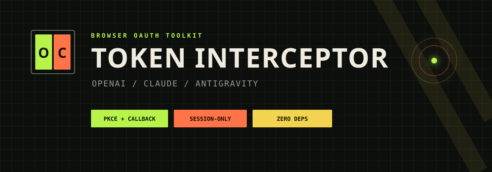

<p align="center">
  
</p>

<p align="center">
  English · <a href="README.md">简体中文</a>
</p>

<p align="center">
  
  
  
  
  
</p>

# openai/claude Token Interceptor

A developer-focused browser OAuth toolkit that handles authorization, callback capture, and token export for OpenAI, Claude, and Antigravity in one Manifest V3 extension.

It is not an account manager and does not upload credentials. Sensitive data stays in local browser storage or the current browser session.

## Why this project

| Capability | OpenAI | Claude | Antigravity |
| --- | :---: | :---: | :---: |
| Generate an official authorization URL | ✓ | ✓ | ✓ |
| Detect OAuth callbacks automatically | ✓ | ✓ | ✓ |
| Accept a manually pasted code | ✓ | ✓ | ✓ |
| Access and refresh tokens | ✓ | ✓ | ✓ |
| Import a login session | ✓ | - | - |
| Observe an existing token request | - | ✓ | - |
| Export local JSON / TXT | ✓ | ✓ | ✓ |

- **One entry point:** no separate throwaway extension for every provider.
- **Real OAuth flows:** authorization uses provider-owned pages and token endpoints.
- **Isolated state:** provider state machines and storage keys do not overlap.
- **Zero runtime dependencies:** no bundler and no install step at runtime.
- **Auditable:** the extension is plain HTML, CSS, and JavaScript.

## Quick start

### 1. Prepare Antigravity credentials

OpenAI and Claude require no extra setup. Antigravity uses the built-in desktop OAuth client from Antigravity Manager. The client secret is intentionally excluded from the repository; synchronize it from a local Manager checkout:

```powershell
npm run setup:antigravity -- "D:\Claude\Antigravity-Manager-main"
```

This creates `config/antigravity-credentials.local.json`, which is excluded by `.gitignore`.

### 2. Load the extension

1. Open `chrome://extensions/` or `edge://extensions/`.
2. Enable Developer mode.
3. Select **Load unpacked**.
4. Choose this project root, the directory containing `manifest.json`.

### 3. Start a flow

Open the extension from the browser toolbar, choose OpenAI, Claude, or Antigravity, then use the primary action in that provider panel.

## Provider notes

### OpenAI

The extension creates PKCE parameters and opens the OpenAI authorization page. When the browser navigates to `localhost:1455/auth/callback`, the extension captures the code before navigation and exchanges it automatically.

It also supports page-response token capture, manual code/verifier exchange, ChatGPT `sessionToken` import, and TXT/JSON export for up to 20 local records.

### Claude

The extension generates a Claude PKCE URL and detects the authorization code on Anthropic's callback page. Token exchange runs inside a temporary `platform.claude.com` browser context.

The optional compatibility listener uses `chrome.debugger` to read an existing Claude token response. It detaches after capture or when stopped by the user.

### Antigravity

The extension mirrors the desktop OAuth flow used by Antigravity Manager:

- Six Antigravity/Google scopes.
- `access_type=offline` and `prompt=consent`.
- A dedicated `localhost:1456/oauth-callback` loopback URL.
- Google profile lookup for email and display name.
- Export of access, refresh, ID tokens, and OAuth metadata.

## Security model

- OpenAI history uses `chrome.storage.local`, capped at 20 entries.
- Claude and Antigravity tokens use `chrome.storage.session` and disappear with the browser session.
- The Antigravity client secret lives only in an ignored local credential file. It is never rendered or exported.
- The extension has no telemetry, analytics, or token upload path.
- `chrome.debugger` is limited to the user-initiated Claude compatibility flow and its temporary exchange context.
- Callback host, path, and OAuth state are validated at the extension boundary.

See the [security policy](SECURITY.md), [privacy notice](docs/PRIVACY.md), and [architecture guide](docs/ARCHITECTURE.md) for details.

## Repository layout

```text
.
├── assets/icons/             # Extension icons
├── config/                   # Local credential template (secrets are ignored)
├── docs/                     # Architecture and brand assets
├── scripts/                  # Validation and local credential setup
├── src/
│   ├── oauth/                # Claude and Antigravity protocol modules
│   ├── background.js         # Service worker and message router
│   ├── callback.js           # Claude callback extraction
│   ├── content.js            # OpenAI isolated-world bridge
│   └── injected.js           # OpenAI page-context observer
├── tests/                    # Dependency-free Node.js tests
├── ui/                       # Popup HTML, CSS, and JavaScript
├── manifest.json
└── package.json
```

## Development

Node.js 20 or newer is required for tests only. The browser extension itself has no Node.js dependency.

```powershell
npm test
npm run check
npm run verify
```

Reload the unpacked extension after a change. Any protocol or permission change should include matching tests and documentation.

## FAQ

**The loopback callback page cannot be reached. Did the flow fail?**

Not necessarily. OpenAI and Antigravity callbacks are captured during navigation. Reopen the popup and check the provider state.

**Why does Chrome say that the browser is being debugged?**

That message appears while the optional Claude compatibility listener uses `chrome.debugger`. The extension does not keep tabs attached after capture or stop.

**Why is the Antigravity refresh token missing?**

Google may omit a refresh token for an application that was authorized previously. Revoke the earlier grant and repeat the consent flow.

**Can this be published to an extension store?**

Yes, after providing your own store assets and privacy policy and completing the target store's permission review. Never publish the local credential file.

## Contributing

Run `npm run verify` before submitting a change. See [CONTRIBUTING.md](CONTRIBUTING.md) for project conventions.

## License

[MIT](LICENSE)
