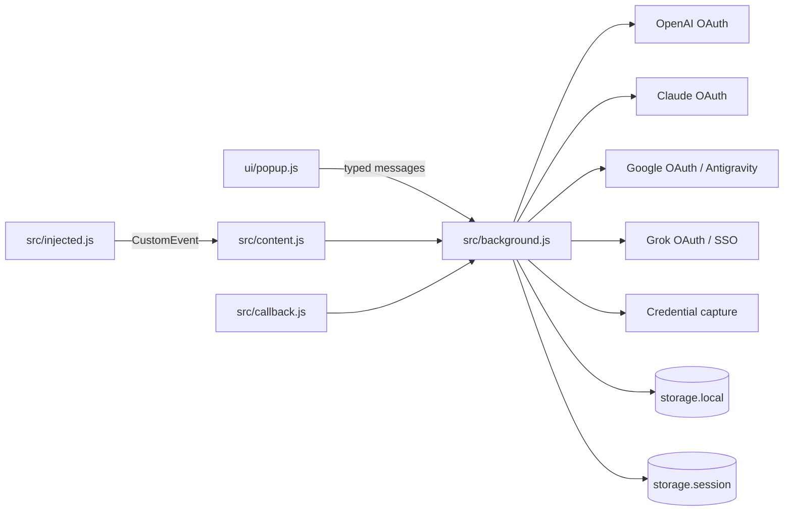

# Architecture

## Design goals

The extension keeps provider-specific OAuth behavior isolated while sharing one popup and one Manifest V3 service worker. The core invariants are:

1. A callback is accepted only for an exact provider-owned or loopback URL.
2. OAuth state and PKCE verifier values never cross provider namespaces.
3. Tokens are never sent to an application-owned remote service.
4. Optional browser debugging is started by an explicit user action and always detached.
5. Provider OAuth client metadata never enters UI state or exported token objects.

## Runtime topology

## Provider flows

### OpenAI

`src/background.js` owns PKCE generation, loopback callback matching and token exchange. `src/injected.js` runs in the page world to observe relevant fetch/XHR responses; `src/content.js` validates and forwards those events across the isolated-world boundary.

OpenAI history uses `storage.local` because the UI intentionally provides a capped local history and bulk export.

### Claude

`src/oauth/claude-flow.js` builds and validates the OAuth flow. `src/oauth/claude-token-parser.js` accepts only known Anthropic token endpoints and token payloads containing both access and refresh tokens.

The service worker performs exchange in a temporary Anthropic tab because the upstream endpoint can reject a generic extension request shape. The optional compatibility mode attaches Chrome DevTools Network to Claude tabs and detaches after capture.

`src/oauth/claude-session.js` parses a pasted Claude `sessionKey` (or a full cookie string / JSON) for cookie-based login import, mirroring the OpenAI and Grok session import paths.

### Antigravity

`src/oauth/antigravity.js` implements the Google desktop OAuth flow: six scopes, offline access, consent prompt, state validation, and no PKCE. A dedicated `localhost:1456/oauth-callback` address avoids colliding with the OpenAI callback.

The provider module owns the OAuth client metadata used during authorization and exchange. The final token record contains only account and token response fields.

### Grok

`src/oauth/grok-oauth.js` implements the Grok CLI authorization-code flow: PKCE S256, a `127.0.0.1:51234/callback` loopback redirect, and a token exchange at `https://auth.x.ai/oauth2/token`. The captured token record contains the access, refresh, and ID tokens plus the email and name decoded from the `id_token`.

`src/oauth/grok-sso.js` parses a pasted Grok `sso` JWT, a full cookie string, or the `/api/auth/session` JSON. The service worker writes the `sso`, `sso-rw`, and optional `x-userid` cookies directly to grok.com using the `cookies` permission. No token is exchanged and no credential is stored in extension storage; the browser cookie store is the single source of truth for the SSO path.

### Credential capture

The `CAPTURE_CREDENTIALS` message reads credentials from the sites the user is already signed in to: OpenAI fetches `chatgpt.com/api/auth/session` and reassembles the session cookie; Claude and Grok read named cookies through `chrome.cookies`. Results are returned to the popup and are never written to extension storage — the popup holds them in memory for copy or JSON file export.

## Message boundary

Popup operations use explicit message types such as `CLAUDE_GET_STATE`, `ANTIGRAVITY_EXCHANGE`, `GROK_GENERATE_AUTH`, and `IMPORT_GROK_SSO`. Provider prefixes are part of the contract and prevent accidental routing to another provider.

All background failures return `{ ok: false, error }`; the popup surfaces the error instead of treating an incomplete exchange as success.

## Storage boundary

| Namespace | Storage | Lifetime |
| --- | --- | --- |
| OpenAI Token history | `storage.local` | Until user clears it |
| OpenAI PKCE | `storage.session` | Browser session |
| Claude OAuth and Token | `storage.session` | Browser session |
| Antigravity OAuth and Token | `storage.session` | Browser session |
| Grok OAuth and Token | `storage.session` | Browser session |
| Grok SSO login cookies | browser cookie store (`grok.com`) | Until user clears or overwrites |
| Captured account credentials | popup memory only | Until popup closes |

## Validation

`scripts/validate-extension.js` checks Manifest references, JavaScript parsing, popup DOM references and optional Antigravity credential shape. Tests under `tests/` validate pure protocol parsing and exercise the service worker with mocked Chrome and network APIs.
