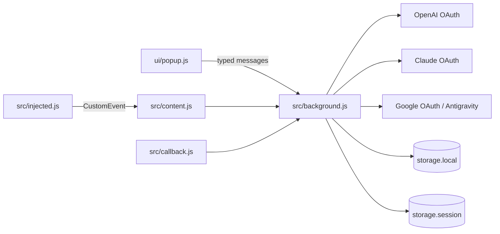

# Architecture

## Design goals

The extension keeps provider-specific OAuth behavior isolated while sharing one popup and one Manifest V3 service worker. The core invariants are:

1. A callback is accepted only for an exact provider-owned or loopback URL.
2. OAuth state and PKCE verifier values never cross provider namespaces.
3. Tokens are never sent to an application-owned remote service.
4. Optional browser debugging is started by an explicit user action and always detached.
5. Antigravity Client Secret material never enters UI state or exported token objects.

## Runtime topology

## Provider flows

### OpenAI

`src/background.js` owns PKCE generation, loopback callback matching and token exchange. `src/injected.js` runs in the page world to observe relevant fetch/XHR responses; `src/content.js` validates and forwards those events across the isolated-world boundary.

OpenAI history uses `storage.local` because the UI intentionally provides a capped local history and bulk export.

### Claude

`src/oauth/claude-flow.js` builds and validates the OAuth flow. `src/oauth/claude-token-parser.js` accepts only known Anthropic token endpoints and token payloads containing both access and refresh tokens.

The service worker performs exchange in a temporary Anthropic tab because the upstream endpoint can reject a generic extension request shape. The optional compatibility mode attaches Chrome DevTools Network to Claude tabs and detaches after capture.

### Antigravity

`src/oauth/antigravity.js` mirrors Antigravity Manager's built-in Google desktop OAuth client: six scopes, offline access, consent prompt, state validation, and no PKCE. A dedicated `localhost:1456/oauth-callback` address avoids colliding with the OpenAI callback.

The service worker reads Client Secret material from `config/antigravity-credentials.local.json` only at exchange time. The file is ignored by version control and is not web-accessible. The final token record excludes the secret.

## Message boundary

Popup operations use explicit message types such as `CLAUDE_GET_STATE` and `ANTIGRAVITY_EXCHANGE`. Provider prefixes are part of the contract and prevent accidental routing to another provider.

All background failures return `{ ok: false, error }`; the popup surfaces the error instead of treating an incomplete exchange as success.

## Storage boundary

| Namespace | Storage | Lifetime |
| --- | --- | --- |
| OpenAI Token history | `storage.local` | Until user clears it |
| OpenAI PKCE | `storage.session` | Browser session |
| Claude OAuth and Token | `storage.session` | Browser session |
| Antigravity OAuth and Token | `storage.session` | Browser session |
| Antigravity Client Secret | Ignored extension-local file | Local filesystem |

## Validation

`scripts/validate-extension.js` checks Manifest references, JavaScript parsing, popup DOM references and optional Antigravity credential shape. Tests under `tests/` validate pure protocol parsing and exercise the service worker with mocked Chrome and network APIs.
